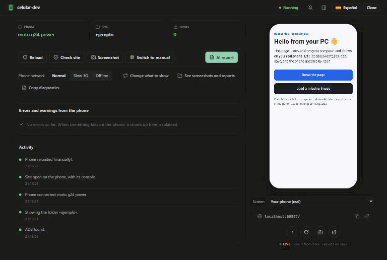
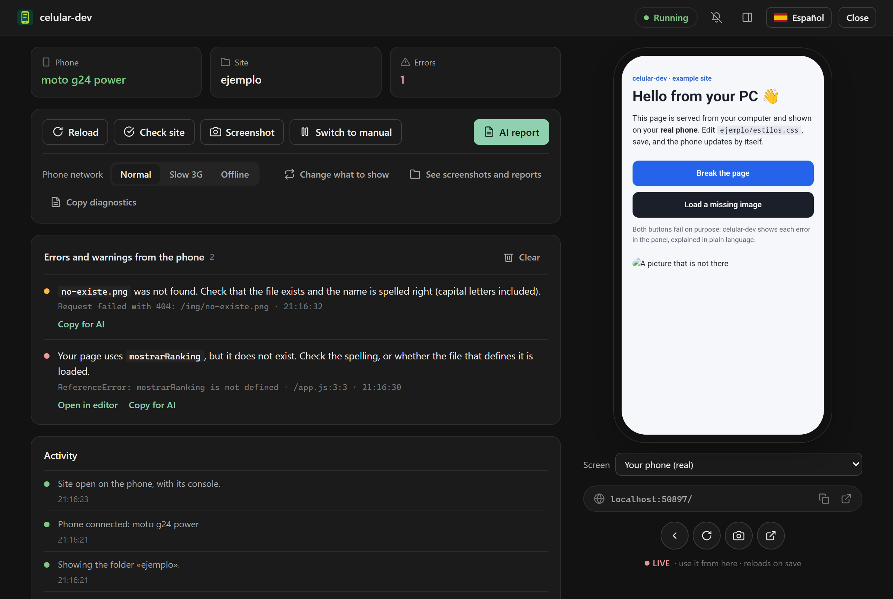
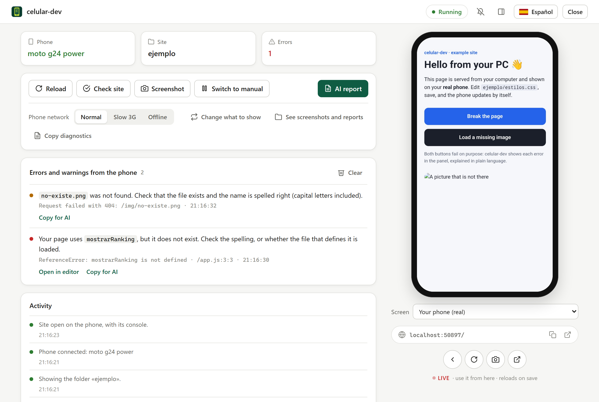

<div align="center">

# celular-dev

**Mirá tu sitio web en un celular Android real, directo desde tu PC.**<br>
Por cable USB, con recarga al guardar, un espejo que se puede tocar y los errores del celular explicados en lenguaje simple.

[](https://github.com/SantiagoNardini/celular-dev/actions/workflows/pruebas.yml)
[](https://github.com/SantiagoNardini/celular-dev/releases)
[](LICENSE)


[**Descargar**](https://github.com/SantiagoNardini/celular-dev/releases/latest) · [English](README.md) · [Manual completo](celular-dev/README.md)



</div>

## Para qué sirve

Probar un sitio en el celular suele ser una mezcla de emuladores, túneles, `chrome://inspect` y adivinar. celular-dev hace la parte aburrida:

1. Conectás el celular.
2. Elegís una carpeta (o el servidor que ya tengas prendido).
3. Tu sitio se abre en el Chrome del celular, **se recarga cuando guardás** y aparece **en vivo en un panel de tu PC**, donde podés tocar, deslizar y escribir.

Cuando algo se rompe en el celular, no te quedás con un mensaje críptico: ves *«Tu página usa `mostrarRanking`, pero no existe. Revisá si está bien escrito o si falta cargar el archivo donde se define.»*, con el archivo y la línea, un botón para abrirlo en tu editor y otro que lo copia para tu asistente de IA.

<p align="center">
  
  
</p>

## Empezar

**Lo más fácil (sin instalar nada):** bajá el paquete de tu sistema desde [Releases](https://github.com/SantiagoNardini/celular-dev/releases/latest): Windows, Mac (Apple Silicon e Intel) o Linux. Node viene incluido. Descomprimí y hacé doble clic en `celular-dev.bat` (Windows) o `celular-dev.command` (Mac), o ejecutá `./celular-dev.sh` (Linux).

**Con Node 22 o más nuevo:**

```bash
npx github:SantiagoNardini/celular-dev
```

En el celular hace falta la **depuración USB** activada (el panel te guía paso a paso, con animaciones) y **Google Chrome**. ADB se descarga solo con un clic si no lo tenés.

**Probalo con el sitio de ejemplo** (dos botones que fallan a propósito, para ver los errores explicados):

```bash
git clone https://github.com/SantiagoNardini/celular-dev && cd celular-dev
node celular-dev/bin/celular.mjs --carpeta celular-dev/ejemplo
```

## Qué hace

- **Espejo en vivo que se puede tocar.** La pantalla del celular en el panel: tocá, deslizá, usá la rueda del mouse y escribí con tu teclado. Un cambio se ve en unos 90 ms, y cuando la pantalla se queda quieta llega una imagen nítida a resolución completa.
- **Recarga al guardar.** Con una carpeta común (sin servidor) o con el servidor que ya uses: Live Server, Vite, `npm run dev`…
- **Errores en lenguaje simple.** Excepciones de JavaScript, pedidos fallidos, 404, contenido bloqueado, `console.warn`: agrupados, explicados, con archivo y línea. Los errores de después de recargar se marcan como *Nuevo*; los anteriores se atenúan.
- **Un botón cuando algo falla.** Celular desconectado, servidor apagado, pestaña de Chrome cerrada: el panel dice qué pasó y ofrece un solo botón para arreglarlo.
- **Informe para tu IA.** Un clic copia todos los errores en un formato con el que un asistente puede trabajar. Cada error también tiene su propio *Copiar para la IA*.
- **Probar otras pantallas.** Simulá otros tamaños de pantalla, una red 3G lenta o sin conexión, y hacé una revisión rápida del sitio (desborde, botones chicos, contraste, imágenes sin texto alternativo…).
- **Consola del celular.** La salida de `console.log` junto a los errores.
- **Varios celulares.** Elegís cuál usar cuando hay más de uno conectado.
- **Mantiene la pantalla prendida** mientras corre y deja todo como estaba al cerrar. No deja **nada abierto** de fondo.
- **Windows, Mac y Linux**, en **español e inglés**, con tema claro y oscuro.

## Cómo funciona

celular-dev habla con el celular por ADB (`reverse` hace que el `localhost` de la PC llegue al celular, `forward` abre el acceso a las herramientas de desarrollo de Chrome) y maneja Chrome con el protocolo DevTools. No hay ninguna app en el celular ni nada en la nube: todo queda entre tu PC y tu celular.

Algunas decisiones que lo hacen andar bien:

- **El espejo está hecho para la latencia, no solo para verse bien.** Los cuadros salen de `Page.startScreencast`, se piden al ancho en que el panel los muestra (la latencia crece con los píxeles: 108 ms a 720 px contra 58 ms a 360 px en el celular de prueba) y se dibujan en un `<canvas>`. Un `` con un flujo multipart muestra cada cuadro recién cuando empieza el *siguiente*, así que el último cuadro de una pantalla quieta nunca aparecería: el canvas lo resuelve.
- **Nítido cuando importa.** Mientras interactuás, cuadros livianos; tras 300 ms quieto, una captura a resolución completa recortada al área visible.
- **Se prueba sin celular.** Todo el programa recibe ADB, Chrome, el panel y los diálogos del sistema por inyección, así que más de 130 pruebas recorren el flujo real (arranque, reconexiones, espejo, errores, idioma…) con un celular simulado, en Windows, macOS y Linux en CI.
- **Cero dependencias.** Solo la biblioteca estándar de Node: servidor de archivos propio, escritores de ZIP y tar.gz, y clientes de ADB y DevTools. Los paquetes traen Node, verificado con los checksums que publica.
- **Cierre limpio.** Devuelve la configuración del celular y apaga el servicio de ADB solo si fue él quien lo prendió.

## Estado y próximos pasos

Hoy funciona en el celular de prueba (Motorola moto g24 power, Android 14) y está cubierto por pruebas automáticas en tres sistemas operativos. Por ahora se probó en un solo celular real, así que **los reportes de otros celulares son muy bienvenidos**: usá *Copiar diagnóstico* en el panel y abrí un issue.

Lo que sigue: conexión por Wi-Fi (sin cable), una extensión para VS Code, grabar la pantalla del celular y botones del dispositivo (girar, volumen, inicio).

## Licencia

[MIT](LICENSE) © Santiago Nardini
